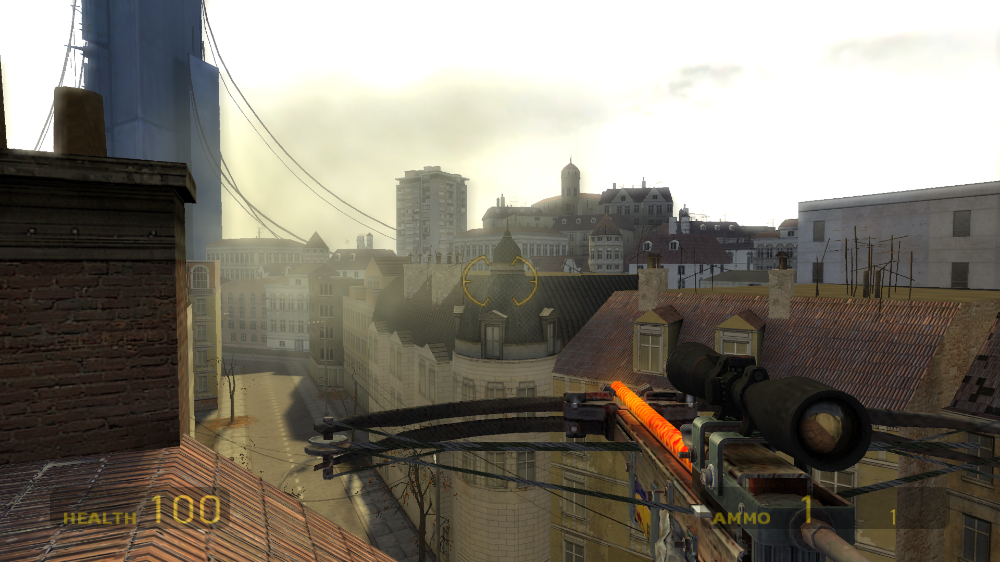
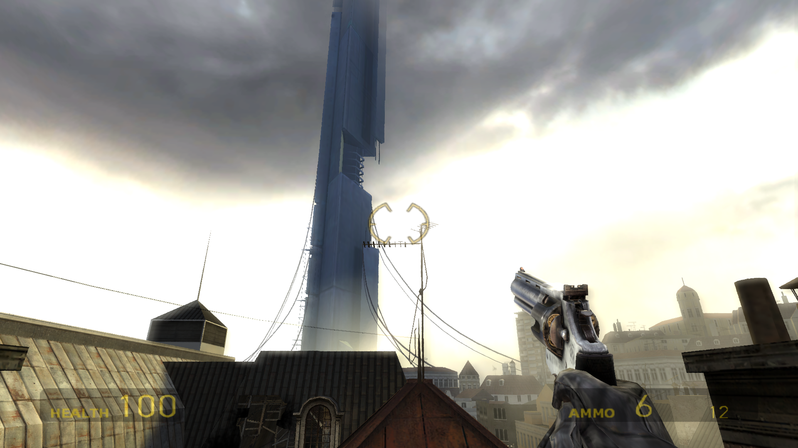

# hl2xbe — Half-Life 2 (Xbox, 2005) recompiled

An experiment in statically recompiling the retail Xbox build of Half-Life 2
to native Windows with [Xbox XBE Recomp](https://github.com/AlexXT/XboxXBERecomp)
— the same patched toolkit used for
[halo2xbe](https://github.com/AlexXT/halo2xbe).

This is a research project, not a finished port. The question is how far a
large, statically linked Source-engine title can be brought up on a different
recompiler design from the one used by
[sp00nznet/hl2-recomp](https://github.com/sp00nznet/hl2-recomp), and what each
toolchain finds when it fails.

> [!NOTE]
> No game assets are included. You must own a copy of the game and supply your
> own disc image or extracted files.

## What is here

```
sdk/          the Xbox XBE Recomp toolkit as a git submodule (the patched fork)
config/       game.toml, written by xbe_symbols from the XBE
src/game/     game-specific hooks
tools/        HL2-specific analysis tools (symbol/archive recovery)
ref/          reference checkouts, gitignored (hl2-recomp tools, Source SDK 2013)
assets/       your disc image or extracted data, gitignored
generated/    lifted C, gitignored
out/          build output, gitignored
```

## The two XBEs

The disc has `default.xbe` (the loader) and `hl2_xbox.xbe` (the game). This
project recompiles **the game**. The loader's own LZX decompressor is reused
offline to turn the disc's `.xz_` archives into the `.xzp` files the engine
reads; it is not reimplemented. The archives store many files twice, which
gives a built-in way to verify an extraction byte-for-byte.

## Status

Early. Nothing has been run yet — the game files are still being acquired.
The first gates, in order:

1. `xbe_symbols` names the XDK library for the game's build (XDK 1.0.5849).
2. The lifted game reaches its engine loop (headless harness first).
3. A first frame appears, and the D3D12 path is compared with the NV2A
   pushbuffer that the retail title actually submits.

## Building

Put `hl2_xbox.xbe` and the game's data folders in `assets/` (or a disc image),
then run `build.bat`. The first build recompiles the whole game and takes a
while. `xbe_symbols.exe` and `xbe_recomp.exe` are built by CMake from the
`sdk/` submodule — no separate tool download.

If you already have the pinned third-party sources cached locally, set
`XBE_DEPS_CACHE` to that folder before building to skip the network fetch:

```powershell
$env:XBE_DEPS_CACHE = 'D:\mygame\deps-cache'
```

## Screenshots

Retail Xbox Half-Life 2, recompiled and running natively:





## Credits

- [Xbox XBE Recomp](https://github.com/AlexXT/XboxXBERecomp) — the recompiler
  and runtime, forked from [TGP482](https://github.com/TGP482/XboxXBERecomp)
  via [hk21x](https://github.com/hk21x/XboxXBERecomp).
- [sp00nznet/hl2-recomp](https://github.com/sp00nznet/hl2-recomp) — the
  RTTI/datamap recovery techniques and archive verification this project
  builds on. That project is MIT-licensed.
- Valve — Half-Life 2 and the Source engine. No Valve code or assets are in
  this repository.
